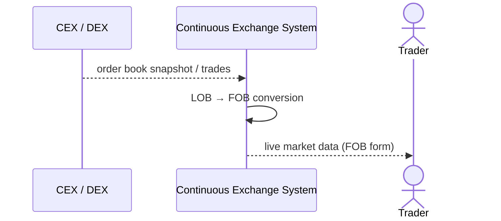

<!-- IN-013 frontmatter — Cockburn decomposition level.
---
id: SEQ-UC-F11-06-system
level: kite
---
-->

# SEQ-UC-F11-06-system. External Market Data (legacy, formerly UC-F11-01): system view

## Type

System Context Sequence (historical artifact — see use-case.md DEPRECATED note)

## Feature

- [F-11](../../../features/F-11-external-venues-lob-to-fob/)

## Use Case

- [UC-F11-06 (legacy)](../use-case.md)

## Participants

- CEX / DEX
- Continuous Exchange System
- Trader (косвенно — получает обновлённый market data)

## Diagram

## Related Service Sequence

N/A — исторический артефакт, собственной service-sequence не имел. Актуальная
service-sequence (`SEQ-F11-UC-F11-01-services.md`) принадлежит
[UC-F11-01 Onboard venue](../../UC-F11-01-onboard-venue/use-case.md).
