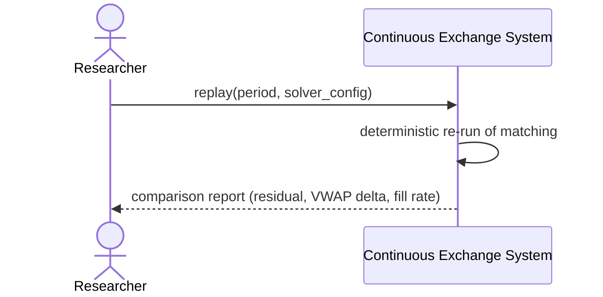

<!-- IN-013 frontmatter — Cockburn decomposition level.
---
id: SEQ-UC-F15-07-system
level: kite
---
-->

# SEQ-UC-F15-07-system. Replay (legacy, formerly UC-F15-01): system view

## Type

System Context Sequence (historical artifact — see use-case.md superseded note)

## Feature

- [F-15](../../../features/F-15-backtest-replay/)

## Use Case

- [UC-F15-07 (legacy)](../use-case.md)

## Participants

- Researcher / Operator
- Continuous Exchange System

## Diagram

## Related Service Sequence

N/A — исторический артефакт, собственной service-sequence не имел. Актуальная
service-sequence (`SEQ-F15-UC-F15-01-services.md`) принадлежит
[UC-F15-01 Create Replay Session](../../UC-F15-01-create-replay-session/use-case.md).
