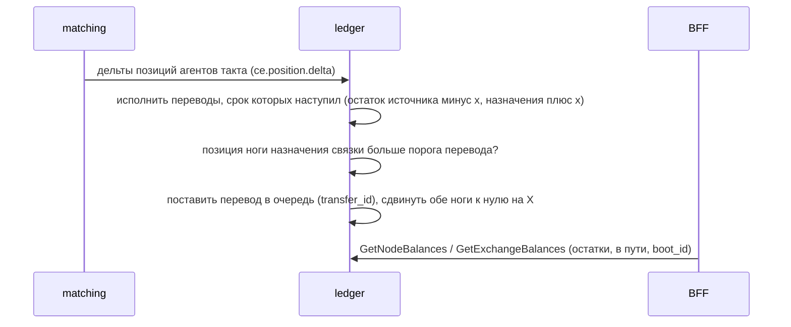

# ADR-084 — Физический перевод связки CE между биржами

> **Статус: accepted (2026-10-22).** Принято владельцем в порядке работ по ADR-083 («Да, давайте по порядку», «принять предложения»): порог перевода — по накопленному перекосу с учётом платы за перевод; срок — 3 такта, настраиваемый; тариф — ноль, как в клиринге сейчас; на dev переводится смоделированно. Реализует направление, заложенное в [ADR-083](ADR-083-ce-link-parity-residual-and-no-market-hedge.md) и OQ-F18v2-11.

## Контекст

Связка (она же арбитражёр) по теории («Кривые котирования» §1.2, §7; CE_algorithm_v2) закрывает накопленный перекос запасов между биржами **физическим переводом актива**, а не рыночными заявками. После ADR-083 у связки внешних действий нет вовсе: её позиция (накопленный неисполненный поток, в тыс. USDT; положительная нога — биржа назначения, отрицательная — биржа источника) копится, а сдвиг якоря от позиции (ADR-071) тормозит её поток на уровне, где якорь сравняется с разрывом цен. Без сброса позиции круг клиринга затухает, а переводчики остаются без встречной стороны.

Что уже есть в системе:

- контракт `ApplyNodeTransfer` (списание с биржи-источника, приход на биржу назначения, идемпотентно по `transfer_id`) описан в `ledger.proto`, но в ledger не реализован; в `risk_uc.cpp` перевод в пути — заглушка (`in_transit = 0`);
- реальные остатки биржи по валютам и узлам «валюта@площадка» ledger хранит в памяти (`GetExchangeBalances`, `GetNodeBalances`): свои счета плюс чистые результаты хеджей на каждой внешней бирже;
- порог выхода позиции за полосу для арбитражёра ledger уже считает по плате за перевод (`TransferFeeBps`, ADR-080).

Связанные решения:

| ADR | Что решено |
| --- | --- |
| ADR-057 | Трёхуровневая позиция «агент / узел / актив»; контракт перевода между узлами |
| ADR-061 | Позиция агента знаковая, без цели; действие наружу при выходе за полосу $\pm q$ |
| ADR-069 | Перевод между биржами разделён на две ноги позиции: источник минус, назначение плюс |
| ADR-071 | Поток связки тормозится сдвигом якоря от накопленной позиции |
| ADR-073 | Связка не выставляет рыночный хедж; её позиция — дисбаланс остатков |
| ADR-080 | Клиринг без барьеров; плата за перевод входит в порог выхода арбитражёра |
| ADR-083 | Остаток паритета принадлежит связке; рыночный хедж ног отключён; целевое действие связки — перевод |

## Решение

1. **Когда переводить.** Роль ноги определяет накопленный знак её позиции: нога с положительной позицией — биржа назначения $d$ (дефицит запаса, нужен приход), зеркальная нога с отрицательной позицией — источник $s$; перевод везёт актив от отрицательной ноги к положительной. Знаки совпадают с проекцией клиринга: при потоке $f>0$ нога источника получает $-f$, назначения $+f$ (ADR-069); при $f<0$ роли меняются. Перевод запускается, когда позиция ноги назначения **строго** больше порога перевода $\bar Z_A$ (тыс. USDT). Проверка идёт на каждом такте по всем ногам связок, а не только по тем, что получили дельту: при нулевом потоке matching запись не шлёт, а позиция над порогом (накоплена до включения флага, поднята из PostgreSQL после перезапуска, не ушла из-за минимума суммы) должна уйти и без новой дельты. Порог считается по плате за перевод, без рыночных комиссий (перевод не торгует на рынке): $\bar Z_A=\max\bigl(q_{\text{пол}},\ k_{band}\,c_{tr}\bigr)$, где $c_{tr}$ — плата за перевод в базисных пунктах (`CE_TRANSFER_FEE_BPS_<актив>`, по умолчанию 2,5 б.п.), $k_{band}$ — коэффициент ширины полосы, $q_{\text{пол}}$ — пол порога из конфигурации. Это тот же вид, что $\bar Z_{lim}=c_{lim}/\Gamma$ в «Кривых котирования» §6.4, где порог ребалансировки связки задают издержки перевода (§7, п. 7.2). Правила для остальных режимов ширины:
   - **ручная ширина** (ADR-081): порогом перевода служит заданная оператором $q_{lim}$;
   - **$k_{band}\le 0$** (привязка к комиссии выключена): плоский порог `CE_AGENT_BAND_Q_ARBITRAGEUR` (по умолчанию 30 тыс. USDT);
   - **масштабы** по волатильности, ликвидности, весу ноги $\omega$ и множитель арбитражёров `ce_band_arb_scale` к порогу перевода **не применяются** (они настраивали редкие рыночные заявки; у перевода нет рыночного риска);
   - **нумерарий** (перенос USDT) не переводится: его остаток по-прежнему сметается в счёт дома.

   *Допущение MVP.* $k_{band}$ взят от переводчика ($k_{band}=1/\Gamma$ с $\Gamma=\gamma\sigma^2\tau$ по волатильности актива). Теория (§7, п. 7.2) требует $\Gamma_A$ связки по дисперсии базиса за время перевода; это отдельная калибровка, пока открытая. Пол $q_{\text{пол}}$ и стоимостная ветвь $k_{band}c_{tr}$ — две ветви порога; при значениях по умолчанию ($q_{\text{пол}}=5$, $k_{band}=1{,}8$, $c_{tr}=2{,}5$) побеждает пол (5 против 4,5). Обе ветви покрыты тестом.
2. **Сколько переводить.** Позиция ноги назначения уменьшается до цели $Z_{targ}=\varphi\,\bar Z_A$ (доля $\varphi$ = `CE_TRANSFER_TARGET_FRAC`, по умолчанию 0,5; допустимо $0\le\varphi<1$, иначе берётся 0,5: при $\varphi\ge 1$ перевод ничего не сбрасывал бы). Сумма перевода $X=\min\bigl(c_d-Z_{targ},\ |c_s|\bigr)$ (тыс. USDT); обе ноги сдвигаются к нулю на $X$: $c_d\leftarrow c_d-X$, $c_s\leftarrow c_s+X$. При зеркальных ногах ($|c_s|=c_d$) минимум всегда первый член; второй срабатывает, если зеркальность уже нарушена (отдельный возврат остатка одной ноги, потеря дельты), и тогда сумма ног $c_d+c_s$ всё равно сохраняется. Защиты: перевода нет, если нет зеркальной ноги с отрицательной позицией, если $X\le 0$, если $X$ меньше минимума `CE_TRANSFER_MIN_K` (по умолчанию 0,05 тыс. USDT), если у любой из ног нет цены. После срабатывания $X>(1-\varphi)\bar Z_A$, поэтому мелких частых переводов нет.
3. **Сколько штук и по какой цене.** Штуки актива $x = X\cdot 1000/P_s$, где $P_s$ — цена источника (`base_price` его ноги, цена узла клиринга) на момент постановки (она берётся с последней дельты ноги и у ноги, не получавшей дельт, может немного отстать — допущение MVP); округление вниз до 8 знаков, чтобы не уйти больше, чем покрывает сумма. Значение, нужное назначению по стоимости, $X\cdot 1000/P_d$; расхождение $r=X\cdot 1000\,(1/P_s-1/P_d)$ штук — **остаток паритета** (Кривые §8.2, ADR-083 п. 1): по знаку он систематический и копится на одной стороне. Ledger не вносит его в проводки (приход всегда $x$), а считает как диагностику: пишет в журнал решения и накапливает по связке и активу (`LinkParityResidual`). Тест: $r=0$ при равных ценах, $r>0$ при $P_d>P_s$.
4. **Как проводится.** Перевод ставится в очередь и исполняется через `CE_TRANSFER_ETA_BATCHES` тактов клиринга (по умолчанию 3, как в теории; такт = каждый новый `batch_id`). Позиции ног сдвигаются сразу при постановке (как эмиссия хеджа сокращает $c$ по A7), остатки бирж — при исполнении: источник уменьшается на $x$, назначение увеличивается на $x\,(1-\text{fee})$, где $\text{fee}=\text{bps}/10^4$ — плата симуляции (`CE_TRANSFER_SIM_FEE_BPS`, по умолчанию 0, как тариф 0 в клиринге). `transfer_id` детерминирован: `xfer|агент|актив|назначение|batch_id`; повтор такта не создаёт второго перевода.
   - **Расхождение платы.** Порог содержит плату $c_{tr}$ (2,5 б.п.), симуляция удерживает `CE_TRANSFER_SIM_FEE_BPS` (0). Это осознанно: решение владельца «тариф 0 в клиринге» (ADR-080) не меняется, а порог по реалистичной плате не даёт связке переводить мелочь. Расхождение записано и снимается, когда тариф клиринга станет ненулевым.
   - **`in_transit` — информационный.** Источник списывается, а назначение зачисляется одновременно, при исполнении; до этого приход виден в `NodeBalance.in_transit` назначения, но в `qty` и в сумму по валюте не входит (двойного счёта нет). Теория A8 списывает при отправке, держит сумму в пути во владении и зачисляет в срок; в симуляции это упрощено, сумма по валюте остаётся постоянной всё время, а `risk` пока читает `in_transit = 0`, поэтому значение служит справкой.
5. **Идемпотентность, перезапуск, баланс.** Повторная заявка с тем же `transfer_id` игнорируется (память ограничена: при переполнении журнала идентификаторов забываются исполненные, переводы в очереди остаются). Количество внешней заявки `ApplyNodeTransfer` проверяется до расчётов: масштаб вне 0…12 отклоняется. Очередь и остатки бирж живут в памяти ledger и обнуляются вместе: при перезапуске переводы в очереди теряются вместе с остатками, на которые они подействовали бы, поэтому суммарные остатки остаются согласованными. Позиции ног сохранены в PostgreSQL уже сниженными; потеря перевода означает, что обязательство «перевезти» снято без физического эффекта. Для dev это допустимо (остатки бирж всё равно начинаются с нуля); для боевого режима нужен постоянный учёт переводов (см. «Отложено»).
6. **Переключатель.** Флаг `CE_ARB_TRANSFER_ENABLED` (по умолчанию выключен). При включённом флаге перевод заменяет рыночный хедж ног связки независимо от `CE_ARB_MARKET_HEDGE`.
7. **Инвариант узлового баланса.** Сдвиг $c_j$ на $X$ меняет сумму позиций по узлу: $(Wc)_d$ уменьшается на $X$, $(Wc)_s$ растёт на $X$ (сумма по узлам сохраняется). Чтобы монитор `W·c` (журнал «F-18 system invariants») не показывал ложную невязку, каждая нога хранит сдвиг от переводов (`transfer_moved`: приход $+X$, уход $-X$), и монитор проверяет $(Wc)_n+\text{moved}_n=0$. Сброс позиций агентов обнуляет и сдвиг; при перезапуске ledger сдвиг теряется (позиции читаются из PostgreSQL уже сниженными), и монитор для затронутых узлов показывает остаток до сброса позиций — это диагностика, на деньги не влияет.
8. **Учёт метрики системы.** Остатки бирж ledger обнуляются при перезапуске, и блок «Система по остаткам» увидел бы ложный торговый результат. Поэтому `GetExchangeBalances` отдаёт идентификатор запуска ledger (`boot_id`), а BFF при его смене задаёт новую базу и переносит накопленные значения (раздел «Учёт» CALC-CE-SYSTEM-PNL). Перевод при нулевой плате прибыль системы по остаткам не затрагивает: меняется разрез по биржам, а не сумма по валюте; плата даёт $\Delta T=-\text{fee}\cdot x\cdot m_a$.

## Последовательность

## Альтернативы

- **Копировать перевод рыночными заявками** — отклонено: ADR-083 (удвоение оборота либо уничтожение арбитража).
- **Мгновенный перевод без срока** — отклонено: срок перевода входит в риск связки по теории ($\alpha_A$ определяется временем перевода); срок 3 такта задаёт реалистичное окно.
- **Хранить очередь переводов в PostgreSQL** — отложено: остатки бирж тоже в памяти ledger; перенос обоих в базу — отдельное решение.
- **Считать порог перевода с рыночными комиссиями** — отклонено: перевод не торгует на рынке; в пороге только плата за перевод.

## Последствия

Положительные:

- позиция связки сбрасывается, сдвиг якоря отпускает поток, круг клиринга продолжается;
- остатки по биржам перебалансируются (хеджи переводчиков копят чистую позицию на одной бирже и убывают на другой);
- метрика «Система по остаткам» устойчива к перезапуску ledger.

Отрицательные и риски:

- в симуляции остатки бирж — чистые результаты хеджей (могут быть отрицательными), а не кастодиальные средства, поэтому проверки «объём перевода не больше 95 % остатка источника» (CE_algorithm_v2, A5) не применяются;
- остаток паритета связки в штуках (теория, блок 6) этим решением не учитывается: ведомость по участникам остаётся отдельной задачей;
- перезапуск ledger теряет очередь переводов и остатки бирж (допустимо для dev, см. п. 5);
- $k_{band}$ переводчика вместо $\Gamma_A$ связки по дисперсии базиса — калибровка MVP;
- остаток паритета в штуках только измеряется, ведомость связки по нему не ведётся.

Отложено:

- постоянный учёт переводов и остатков бирж в PostgreSQL (нужен до боевого режима);
- $\Gamma_A$ связки по дисперсии базиса за время перевода;
- ведомость остатка паритета (теория, блок 6).

## Ворота проверки

- переводы выполняются: в журнале ledger есть `F-18 link transfer decision`, `F-18 node transfer queued` и `F-18 node transfer settled`;
- сумма остатков по каждой валюте при нулевой плате не меняется переводом;
- позиции связок ограничены: $|c|\le \bar Z_A+f_{max}$, где $f_{max}$ — наибольший приток связки за такт;
- монитор `W·c` с поправкой на переводы не краснеет: $(Wc)_n+\text{moved}_n=0$;
- поток по рёбрам связок не падает ниже уровня до включения (круг не затухает);
- заявки и позиции переводчиков не деградируют; ошибок в журналах ledger нет;
- блок «Система по остаткам» не получает ложного торгового результата при перезапуске ledger (смена `boot_id`).

## Результат проверки ворот (2026-10-22)

Образ BFF и фронта обновлены раньше, `ledger` пересоздан в 17:29 UTC с `CE_ARB_TRANSFER_ENABLED=1` (`CE_ARB_MARKET_HEDGE=0`, срок 3 такта, цель 0,5 порога, плата симуляции 0). Порог перевода на dev равен 4,5 тыс. USDT (стоимостная ветвь $1{,}8\cdot 2{,}5$ выше пола). Наблюдение около 15 минут, выборка 224 тактов клиринга. Юнит-тест `ce_link_transfer_test` и шесть соседних ledger-тестов в сборочном образе прошли.

| Ворота | Результат |
| --- | --- |
| Переводы выполняются | выполнено: 79 решений за 4 минуты (около 20 в минуту на 18 связок), каждое проходит `queued` → `settled` через 3 такта; в журнале `from_total` источника убывает, `to_total` назначения растёт |
| Сумма по валюте не меняется (плата 0) | выполнено по построению и тестом: источник −x, назначение +x в одной проводке |
| Позиции связок ограничены | выполнено: сумма модулей по ногам 68–80 тыс. USDT (до включения 102–150); положительные ноги возвращаются к цели 2,25 при каждом срабатывании |
| Нет рыночных заявок связок | выполнено: новых заявок связок нет (идентификаторы хеджей агентов с префиксом A_ не появляются), `in_flight` связок 0 |
| Поток по рёбрам связок не падает | выполнено: средний модуль потока 0,653 тыс. USDT за такт у связок (до 0,49–0,60) и 0,838 у переводчиков (до 0,79–0,94); поток ненулевой на всех рёбрах |
| Заявки переводчиков не деградируют | выполнено: 856 заявок за 10 минут (до 710–907); сумма модулей позиций без `in_flight` сразу после рестарта 40–71 тыс. (до 29–53), через 30 минут 40–62 тыс. при `in_flight` 44–92 тыс. и 777 заявках за 10 минут: в пределах обычного разброса, деградации нет |
| Блок «Система по остаткам» устойчив к перезапуску | выполнено: ребейз по смене `boot_id` сработал (`ledger restarted … carried T=3151.80 V=-3868.89`), итоги продолжили ряд без скачка, торговый результат за 10 минут 3696 → 4087 без ступенек от переводов |
| Ошибок нет | выполнено: ERROR в журналах `ledger` и BFF — 0 |

Остаток паритета на переводе: от $10^{-6}$ BTC до 0,05 SOL, что соответствует межбиржевому базису 0–7 б.п. от суммы перевода.

Повторный замер через 30 минут (17:57–18:00 UTC): сумма модулей ног связок 63–80 тыс., наибольшая нога 5,3–7,2 тыс., около 9 переводов в минуту, ошибок 0.

Замечания по наблюдению:

- Первые 30–40 секунд после рестарта переводы шли на каждом такте: `ledger` разбирал накопленные такты, а позиции из PostgreSQL были выше порога. В установившемся режиме около 20 переводов в минуту.
- Положительная нога сбрасывается до цели, а отрицательная без зеркала (остаток прежних рыночных хеджей, например `A_SOL_binanceokx` −8,8 тыс.) уменьшается только на то же $X$: перевод сохраняет сумму ног связки. Для чистого старта связок нужен сброс позиций агентов (решение владельца).
- Первая версия порога использует стоимостную ветвь $k_{band}c_{tr}$ с коэффициентом переводчика; калибровка по дисперсии базиса остаётся открытой.

## Обратимость

Полная: `CE_ARB_TRANSFER_ENABLED=0` возвращает поведение ADR-083. Очередь переводов в памяти; миграций нет. Накопленные переводом остатки бирж и сдвиги позиций остаются до сброса позиций агентов или перезапуска ledger.
